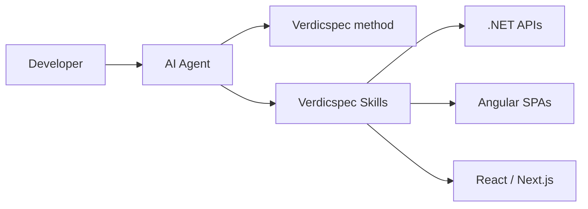

# Verdicspec Skills

Reusable [Agent Skills](https://skills.sh) for **.NET**, **Angular**, **React / Next.js**, Clean Architecture patterns, and developer workflows.

Part of the **Verdicspec** ecosystem: [Verdicspec](https://github.com/luismpenholato/verdicspec) is the portable specification-driven method; **Verdicspec Skills** is the installable library of concrete skill recipes agents follow in day-to-day coding.

[](https://github.com/luismpenholato/verdicspec-skills/actions/workflows/validate-skills.yml)
[](LICENSE)
[](https://github.com/sponsors/luismpenholato)

## About

**Verdicspec Skills** is a local-first collection of Markdown-based skills. Each skill encodes proven conventions — vertical slices, CQRS, typed frontends, validation and tests — so agents produce consistent, reviewable code instead of generic boilerplate.

The repository stays intentionally simple: no web app, no published runtime package. Skills are plain files you install, reference, or copy into your workspace.

Skills are **stack-oriented**, not tied to a single starter. Adapt folder prefixes, UI kits and persistence choices to the target project. Starters such as [CleanStack](https://github.com/luismpenholato/clean-stack) may install these skills; they are not required.



## Available skills

### Stack

| Skill | Target | Main use cases |
|---|---|---|
| [dotnet-backend-clean-architecture](skills/dotnet-backend-clean-architecture/) | .NET 10 | Clean Architecture APIs, CQRS, MediatR, FluentValidation, EF Core, FluentMigrator, Refit |
| [angular-frontend-clean-architecture](skills/angular-frontend-clean-architecture/) | Angular 21 | Standalone apps, signals, vertical slices, OnPush, ng-zorro, Vitest |
| [react-nextjs-antd-clean-architecture](skills/react-nextjs-antd-clean-architecture/) | React 19 / Next.js 16 | App Router, Ant Design, TanStack Query, React Hook Form, Zod |

### Cross-cutting

| Skill | Target | Main use cases |
|---|---|---|
| [application-security-review](skills/application-security-review/) | Any stack | AuthZ/AuthN, secrets, injection, XSS, IDOR, SSRF, CORS, supply chain |
| [api-http-testing](skills/api-http-testing/) | .NET / Node APIs | Handler unit tests, integration (Testcontainers), contract checks |
| [observability-logging](skills/observability-logging/) | .NET / Node / Next | Structured logs, correlation, metrics, safe diagnostics |

## Installation

Requirement: [Node.js](https://nodejs.org/) 20+ (to use `npx`).

Exact install destination and flags depend on the Agent Skills CLI and the target agent.

### List skills

```bash
npx skills add luismpenholato/verdicspec-skills --list
```

### Install a skill

```bash
npx skills add luismpenholato/verdicspec-skills --skill dotnet-backend-clean-architecture
npx skills add luismpenholato/verdicspec-skills --skill angular-frontend-clean-architecture
npx skills add luismpenholato/verdicspec-skills --skill react-nextjs-antd-clean-architecture
npx skills add luismpenholato/verdicspec-skills --skill application-security-review
npx skills add luismpenholato/verdicspec-skills --skill api-http-testing
npx skills add luismpenholato/verdicspec-skills --skill observability-logging
```

Use CLI flags such as `--global` or `--agent` when available. Not every agent supports automatic installation — see [Compatibility](#compatibility).

## Usage examples

### Backend (.NET)

> Use the dotnet-backend-clean-architecture skill to add an Orders feature with create, update, list and get-by-id, including validation, migration and unit tests.

Expected: Commands/Queries per feature, DI registration, tests mirroring Application.

### Angular

> Use the angular-frontend-clean-architecture skill to create an Orders listing and form with Angular 21, signals, OnPush and ng-zorro.

Expected: vertical slice under `pages/orders/`, routes in `app.routes.ts`, OnPush + signals.

### React / Next.js

> Use the react-nextjs-antd-clean-architecture skill to create an Orders feature with App Router, Ant Design, TanStack Query, React Hook Form and Zod.

Expected: feature under `src/features/orders/`, thin route in `src/app/`, HTTP in `shared/lib/api/`.

## Compatibility

| Agent / tool | Expected usage |
|---|---|
| Cursor | Install or reference the skill in the workspace |
| Codex | Use as repository or task context |
| Claude Code | Use when Agent Skills-compatible install is available |
| Other agents | Copy or reference the relevant `SKILL.md` manually |

## Repository structure

```txt
verdicspec-skills/
├── .github/
├── scripts/validate-skills.mjs
├── skills/
│   ├── application-security-review/
│   ├── api-http-testing/
│   ├── observability-logging/
│   ├── dotnet-backend-clean-architecture/
│   ├── angular-frontend-clean-architecture/
│   └── react-nextjs-antd-clean-architecture/
├── CHANGELOG.md
├── CONTRIBUTING.md
├── LICENSE
├── package.json
├── README.md
└── SECURITY.md
```

Each skill folder has `SKILL.md` (YAML frontmatter + instructions). Optional `reference.md` holds long examples and flows.

## Validation

```bash
npm ci
npm run validate
```

CI runs the same checks on every push/PR to `main` via [Skills Validation](.github/workflows/validate-skills.yml).

## Related

- [Verdicspec](https://github.com/luismpenholato/verdicspec) — specification-driven method and agent adapters
- [CleanStack](https://github.com/luismpenholato/clean-stack) — optional fullstack starter that can consume these skills

## Contributing

See [CONTRIBUTING.md](CONTRIBUTING.md).

## Security

See [SECURITY.md](SECURITY.md). Do not open public issues for security-sensitive reports.

## Support

- [Issues](https://github.com/luismpenholato/verdicspec-skills/issues) for bugs, corrections and skill requests
- [GitHub Sponsors](https://github.com/sponsors/luismpenholato) for Verdicspec / Nebula maintenance

## License

[MIT](LICENSE)
